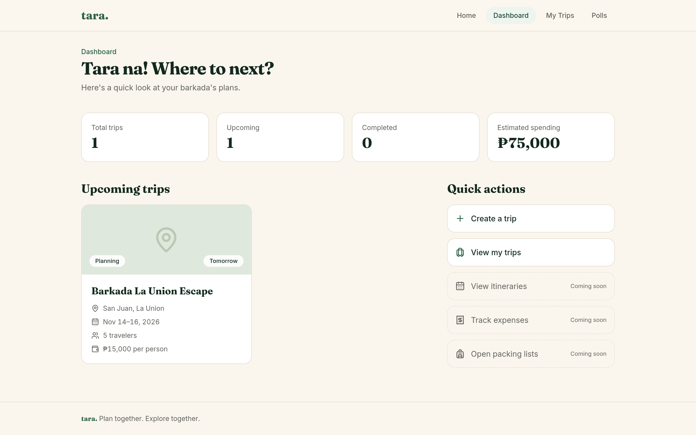
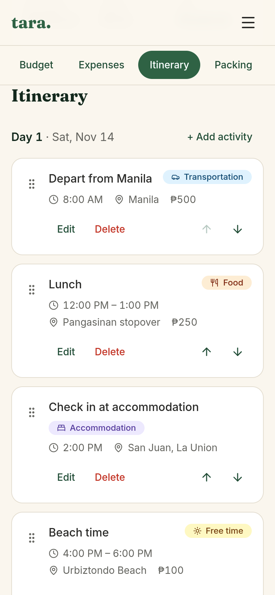

# tara.

**Your next adventure starts here.** Plan together. Explore together.

Tara is a trip-planning web app for Filipino friend groups (barkadas). Plan a trip day by day, set a budget, track and split expenses, share a packing list, and vote on where to go.

> **Status:** a complete front-end app that saves data in the browser (localStorage). Accounts and a shared database are planned as the final phase, see [Roadmap](#roadmap).

**Live demo:** _coming soon_ (add the Vercel link here after deploying)

<!-- Add screenshots after deploying:



-->

## Features

**Trips**
- Create, edit, and delete trips with dates, destination, budget per person, and an optional cover image link
- Dashboard with upcoming trips and summaries calculated from your real data
- Status pills such as "In 2 days", "Happening now", and "Ended"

**Itinerary**
- Day-by-day plan built from the trip's dates
- Add, edit, and delete activities with times, categories, locations, and costs
- Overlap warnings when two activities clash
- Drag-and-drop reordering, plus Move up / Move down buttons for keyboard and screen reader users

**Budget**
- Estimated costs by category, combining budget items and activity costs
- Cost per person, average cost per day, and remaining budget
- Donut chart of the cost breakdown, drawn with plain SVG

**Expenses and splitting**
- Record who paid and who shares each expense
- Equal splits or custom amounts per person (validated to add up exactly)
- Per-person balances and a simple "who pays whom" settlement list
- Spending summaries, filters, and a budget-vs-actual comparison

**Packing list**
- Items grouped by category, with progress
- Starter templates (Beach, Hiking, Overnight stay) that skip items you already have

**Polls**
- Create polls with 2 to 10 options, vote, change a vote, see results, and close a poll

**Quality**
- Responsive layout designed mobile-first
- Accessible: keyboard navigation, skip link, labeled forms, focus management, accessible confirm dialogs, and reduced-motion support
- Philippine peso formatting (₱), centavo-exact money math, and Asia/Manila-friendly dates

## Tech stack

| Area | Choice |
|---|---|
| UI | React, TypeScript |
| Build tool | Vite |
| Styling | Tailwind CSS (design tokens in `src/index.css`) |
| Routing | React Router |
| Animation | Framer Motion |
| Icons | Lucide React |
| Dates | date-fns |
| Drag and drop | dnd-kit |
| Persistence | localStorage |
| Testing | Vitest, Testing Library, jsdom |
| Deployment | Vercel |

## Getting started

Requires Node.js 20 or newer.

```bash
git clone https://github.com/YOUR-USERNAME/tara.git
cd tara
npm install
npm run dev
```

Then open the URL Vite prints (usually http://localhost:5173).

| Command | What it does |
|---|---|
| `npm run dev` | Start the dev server |
| `npm run build` | Type-check and create a production build |
| `npm run preview` | Serve the production build locally |
| `npm run lint` | Run ESLint |
| `npm test` | Run all tests once |

The app starts with one fictional sample trip ("Barkada La Union Escape"). To reset to the sample data, run `localStorage.clear()` in the browser console and refresh.

## Project structure

```text
src/
├── components/   UI grouped by feature: budget, expenses, itinerary, layout,
│                 packing, participants, polls, trips, ui (shared pieces)
├── pages/        One component per route
├── services/     Load/save functions for localStorage (one per data type)
├── utils/        Pure functions: calculations, validation, formatting
├── types/        TypeScript types for the data model
├── data/         Fictional sample data and packing templates
└── test/         Test setup and data builders
```

## Design decisions

- **State lives in `App`.** `useState` holds each list and is passed down as props. The app is small enough that Redux or similar would only add weight. Context is used once, for the confirm dialog, which many components need.
- **Calculations are pure functions, kept out of components.** Budgets, splits, balances, overlap detection, and validation take data in and return results, so they are easy to test. The 270 tests mostly cover this layer.
- **Totals are derived, never stored.** Budget totals, balances, progress, and trip timing are computed from the underlying data on each render, so they cannot go stale.
- **Money is calculated in whole centavos.** This avoids floating-point errors such as `0.1 + 0.2`. Per-person shares round up so a group never falls short, and equal splits give leftover centavos to the first people so shares always add up exactly.
- **Data is linked by stable IDs.** Activities, expenses, and polls point to their trip with `tripId`, and expenses point to people by `id`, so renaming someone never breaks history. Deleting a trip removes everything attached to it, which a test verifies.
- **Bad stored data never crashes the app.** Each load function validates what it reads and falls back safely. An error boundary offers a recovery screen as a last resort.
- **Accessibility is built in.** Native elements first (`<dialog>`, labels, fieldsets), and every drag interaction has a button alternative.

## Testing

```bash
npm test
```

270 tests cover the calculation and validation logic, storage behavior (including corrupted data and blocked storage), and the main user flows: creating a trip, validation messages, persistence across reloads, and cascade deletion.

## Known limitations

- **Data is stored only in your browser.** It is not shared between devices or people, and clearing site data erases it.
- **Polls are not shared.** Votes are recorded by a name typed on the same device, not by a verified identity. Real shared voting needs accounts and a database.
- **Tara records expenses but does not move money or track repayments.** The settlement list is a suggestion.
- **Cover images are links to images hosted elsewhere**, so they depend on those sites staying up.
- All sample trips, people, and amounts are fictional.

## Roadmap

- [x] Trips, dashboard, itinerary, budget, expenses and splitting, packing list, polls
- [x] Accessibility, responsive design, and automated tests
- [ ] Deploy to Vercel
- [ ] Supabase: user accounts, a shared database, row-level security, and truly shared trips and polls

## License

Personal portfolio project. Not licensed for reuse.