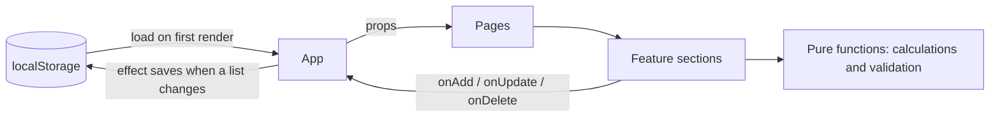
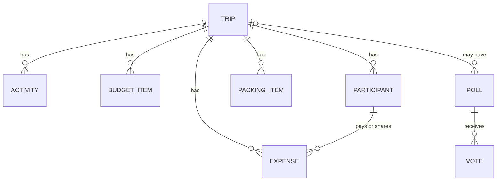

# Architecture

Tara is a client-side React app. All data lives in the browser (localStorage) for now. This document explains how the pieces fit together and why.

## Data flow

State is owned in one place (`App.tsx`) and flows one way: down as props, and back up through callbacks.

- `App` holds eight lists with `useState`: trips, activities, budget items, participants, expenses, packing items, polls, and votes.
- Each list has a small service in `src/services/` that loads and saves it under its own key (`tara.trips`, `tara.expenses`, ...). A `useEffect` per list saves it whenever it changes.
- Lists are loaded with a lazy initializer (`useState(loadTrips)`), so storage is read once, not on every render.
- State is updated immutably (`map`, `filter`, spread), never mutated.
- Context is used once, for the confirm dialog, which many components need. Everything else is plain props, because the app is small enough that a state library would add more than it removes.

## Data model

- Related data is kept in **separate flat lists linked by IDs** (`tripId`, `pollId`, `paidById`), not nested inside the trip. Adding a feature never changes the shape of saved trips, and the layout maps directly onto database tables.
- IDs are stable (`crypto.randomUUID()`). Expenses refer to people by ID, so renaming someone never breaks history.
- Polls can exist without a trip (`tripId` is `null`). Poll options live inside the poll because they have no meaning outside it.
- **Itinerary days are not stored.** They are derived from the trip's start and end dates, so editing the dates can't leave days out of sync.
- Deleting a trip removes everything attached to it (activities, budget items, travelers, expenses, packing items, its polls, and those polls' votes). A test checks this.

## Derived values, not stored values

Totals are calculated from the underlying data whenever they are needed, so they cannot go stale:

| Module (`src/utils/`) | Responsibility |
|---|---|
| `budget.ts` | Estimated costs by category, cost per person, average per day, remaining budget |
| `budgetComparison.ts` | Planned vs estimated vs actual, per category |
| `expenseSummary.ts` | Spending by category and by payer, expense filters |
| `splitExpense.ts` | Each person's share of an expense (equal or custom) |
| `balances.ts` | Paid minus share, per person |
| `settlements.ts` | A short list of who pays whom |
| `itinerary.ts` | Trip days, ordering, overlap detection, drag-and-drop reordering |
| `tripTiming.ts`, `tripFilters.ts` | "In 2 days" / "Happening now", upcoming trips, dashboard summaries |
| `polls.ts` | Results, one-vote-per-name rule, closed-poll rule |
| `validate*.ts` | One validator per form, returning an object of error messages |

These are pure functions with no React in them. Components call them and display the result.

## Money

- Amounts are calculated in **whole centavos** and converted back at the end, which avoids floating-point drift (`0.1 + 0.2`).
- **Per-person estimates round up**, so a group never collects less than the total.
- **Equal splits give leftover centavos to the first sharers**, so shares always add up exactly to the expense. Custom splits are rejected unless they add up exactly.
- Balances always sum to ₱0.00. The settlement list uses a simple greedy method (biggest debtor pays biggest creditor), which needs at most one fewer payment than there are people. It is not guaranteed to be the absolute minimum, because finding the true minimum is a much harder problem and wasn't worth it here.

## Validation and error handling

- Validators are pure functions that return `{ field: 'message' }`. Forms show the messages next to the fields and link them with `aria-describedby`. Browser validation is turned off (`noValidate`), so behavior is consistent and tested.
- Business rules are enforced in logic, not only in the UI. For example, `applyVote` ignores a vote on a closed poll even if a button were somehow clicked.
- Load functions never trust storage: invalid JSON, a non-list value, or blocked storage falls back to the sample data. An error boundary shows a recovery screen (with a confirmed "reset saved data") if rendering ever crashes.
- Sample data dates are generated relative to the visitor's first visit, so the demo always has an upcoming trip.

## Accessibility

- Native elements first: `<dialog>` for confirmations (focus trap, `Esc`, restored focus), real `<label>`s, `<fieldset>` and `<legend>` for groups, radios and checkboxes for choices.
- Every drag interaction has a button alternative. The drag handle is separate from the card, so touch scrolling still works.
- A skip link, focus moved to the page content on navigation, per-page titles, `aria-current` on the active link, and `prefers-reduced-motion` respected.
- Information never depends on color alone: status uses icons and text as well as color.

## Testing

Over 270 tests run with Vitest:

- **Unit tests** for the calculation and validation layer, including edge cases (centavo rounding, back-to-back activities, tied polls).
- **Storage tests** for every list: first visit, empty list, corrupted data, and blocked storage.
- **Component and flow tests** with Testing Library: form validation messages, creating a trip, persistence across a simulated reload, and cascade deletion.
- Time-dependent tests freeze the clock, so they don't depend on today's date.

When adding a test, a useful habit is to break the code on purpose and confirm the test fails.

## Deployment

A static build (`vite build`) hosted on Vercel's free plan, deployed automatically on each push to `main`. `vercel.json` rewrites every URL to `index.html` so deep links and refreshes work with client-side routing. There are no environment variables and no server.

## Known limitations

- Data is stored per browser. It is not shared, and clearing site data erases it. localStorage is also limited to a few megabytes.
- Stored data is checked to be a list, but individual items are not validated against a schema, and there is no versioned migration if the data format changes.
- Polls use a name typed on the same device, which is not a verified identity.
- `TripDetails` receives many props because state lives in `App`. A data layer (or context) would simplify it.
- The JavaScript bundle is a single chunk (about 600 kB, 183 kB compressed). Route-based code splitting is possible but wasn't needed for the performance score.
- Cover images are links to images hosted elsewhere.

## What's next

Supabase for accounts and a shared database: tables that mirror the lists above, row-level security so people only see trips they belong to, and a data layer that replaces the localStorage services. That also adds the loading and error states the app doesn't need today, since localStorage is synchronous.